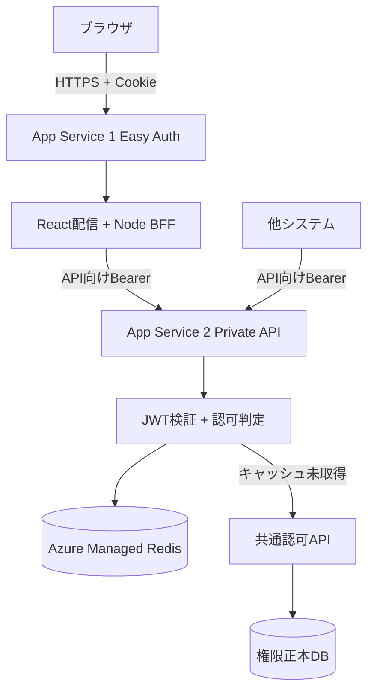

# Azure Webアプリ共通テンプレート：BFF・認証認可・キャッシュ設計

更新日: 2026-10-30
状態: 推奨案（未確定・PoC要）

## 目的と結論

ProcureOneおよび複数の社内業務アプリ向け。優先順位はセキュリティ、保守性、開発効率、コスト、拡張性。React/TypeScriptとNode.js/TypeScriptを使う。APIは他システムやツールからも直接利用できるよう独立させる。

**第一候補**はApp Service①（React SPAの静的配信 + Node.js BFF + Easy Auth）とApp Service②（Private業務API）を分離する構成。標準業務APIにFunctionsを必須採用しない。Redisによる共通認可キャッシュはオプションで、認可判定は必須。



## 構成比較

| 方式 | メリット | 注意点 |
|---|---|---|
| SWA + Functions | 小規模アプリの静的配信、組み込み認証 | 独立Private APIへの委任トークン・ネットワーク連携が難しくなり得る |
| SWA + App Service BFF + Private API | SPAの独立配信 | SWAとBFF間のCookie、CORS、CSRF、同一オリジン化が追加課題 |
| **App Service SPA+BFF + Private API** | Easy AuthとBFFの同居、トークンをブラウザから隔離、独立API | App Serviceコスト、トークン取得設定の確認が必要 |

BFFがPublicでも認証とアクセス制御を適切に構成できる。ただし社内専用ならBFFもPrivate Endpoint化する方向が有力。Private Endpointは入口、VNet統合はプライベートAPIへ向かう通信の出口。DNSとExpressRoute経路も確認する。

## 認証・BFF内部フロー

1. ブラウザがApp ServiceにアクセスするとEasy Authがセッションを検証する。未認証ならEntra IDでログインし、Easy AuthがセッションCookieを発行する。
2. 認証済みのReact画面がBFFのAPIルートを呼ぶ。Easy AuthがBFFの前段で認証をチェックする。
3. BFFは必要に応じて `X-MS-CLIENT-PRINCIPAL` から認証済みユーザーの情報を参照する。
4. BFFはPrivate API向けのアクセストークンを取得し、Bearerヘッダーに設定してAPIを呼ぶ。Easy Authのトークンストアが使える場合でも、取得トークンのaudienceとscopeが対象API向けか確認する。必要ならMSAL Node/OBO等を設計する。
5. Private APIは**毎回**JWTの署名、issuer、audience、期限、scope/roleを検証する。そのうえでトークンのtidとoid等を基に認可判定する。
6. 他システムからの直接呼出しも適切なAPI向けBearerトークンとネットワーク到達性が必須。ユーザー委任とアプリケーション権限では認可モデルを分ける。

**重要**: Principalからアクセストークンを変換、書き換え、再署名するわけではない。PrincipalとAPI向けトークンは別々の情報。ユーザーのOIDをリクエスト本文で自己申告させて信用しない。

## Cookie、JWT、Bearerの違い

- JWT: 署名付きトークン形式。通常Payloadは閲覧可能。改ざんを防止するのではなく、正しい検証で不正変更を検知する。
- Bearer: アクセストークンなどの提示方式。API呼出しではAuthorizationヘッダーを利用。
- Cookie: ブラウザ側の保存・送信の仕組み。JWTもセッション識別情報も格納できる。
- Easy Auth: 通常 `AppServiceAuthSession` という保護済みの認証セッションCookieを利用する。内部が単純なセッションIDのみかは断定しない。独自JWTやPermissionを追加する必要はない。
- HttpOnlyはJSによるCookie値の読み取りを防ぐが、XSSによる不正操作やCSRFまで防ぐものではない。Secure、SameSite、HTTPS、CSRFトークン/Origin検証、CSP等を組み合わせる。
- Cookieが盗まれれば、有効な間はセッションハイジャックの危険がある。アクセス制限、短い期限、盗難時の失効運用を設計する。ログアウトだけで盗まれたコピーが必ず失効するとは限らない。
- `X-MS-CLIENT-PRINCIPAL-ID` がOIDと一致すると決め打ちしない。認可には検証済みのtid/oidクレームを明示的に使う。

## 独自JWTと大量Permission

独自JWTを発行してPermissionを署名する方式は可能。ただしEntra IDのJWTを直接再署名するのではなく別のトークンを発行する。署名鍵、発行、失効の運用負荷が増え、権限変更の即時反映も難しい。Cookie保存時には1個あたり約4KBの制約やHTTPヘッダー肥大化も考慮する。プロジェクト・アプリ別にPermissionが多いProcureOneには独自JWTへ権限を詰め込む方式を推奨しない。

## 共通認可とRedis

**認証は毎回、認可判定も毎回。権限情報の取得だけをキャッシュで省略する。**

```text
Private APIでJWT検証
 -> Redisに権限キャッシュがあるか確認
    -> ある: キャッシュのPermissionで認可判定
    -> ない: 認証付きで共通認可APIを呼出し、TTL付きで保存、認可判定
 -> 許可された業務処理だけ実行
```

ProcureOneでは全アプリのPermissionを同一のユーザー・プロジェクト単位で返す設計なら、アプリIDなしのキーを検討できる。

```text
auth:{tenantId}:{oid}:{projectId}
```

値の例:

```json
{"permissions":["req.reader","req.editor","psr.reader","psr.approver"],"version":1}
```

RedisはKey-Value型NoSQLでJSON文字列などを保存可能。権限情報の正本は共通認可APIとAzure SQL等。キャッシュキーに環境やスキーマバージョンを含めるか、権限変更時の失効方法、TTL、複数アプリ間の権限整合を決める。Redisが利用できなければ共通認可APIへフォールバックし、判定不能ならfail closedとする。

App Service内メモリキャッシュはプロセス/インスタンスごとに分離され、別APIから共有できない。Azure Managed Redisなら複数API/インスタンスで共有できる。Redisは基本的に常時課金型であり、Functionsのような呼出し単位のサーバーレスではない。導入時は公式見積でHA、Private Endpointなども含める。テンプレートではRedisを任意にし、ProcureOneでは呼出頻度と費用対効果を測って採用を決める。

SSOはEntra IDが実現し、Redisは認可キャッシュ共有を担当。React/TanStack Queryに表示用Permissionを短期間キャッシュするのはよいが、ブラウザの状態は改ざん可能なのでAPIが毎回認可する。

## セキュリティ標準

- Easy Authの認証必須設定、許可テナント、条件付きアクセス/MFA
- BFFでCSRF対策、入力検証、転送先の制限、トークン/セッション情報のログ禁止
- APIでJWTと操作権限を毎回検証。ユーザー委任とサービス認証を明確に分ける
- Private Endpoint、VNet、Private DNS、最小権限、Managed Identity、Key Vault
- XSS/CSP、HTTPS、HSTS、SQLパラメータ化、監査ログ、Application Insights
- Bicep、CI/CD、単体/統合テスト、SAST/SCA/Secretスキャン
- Redisの短いTTLと権限更新時失効、障害時fail closed

## 未決定・PoC項目

1. Easy AuthでPrivate APIの適切なaudience/scopeを持つトークンを取得できる設定と挙動。必要ならMSAL Node/OBOの実装方法。
2. 社内ExpressRoute経由でBFFとPrivate APIの接続を確認。Public入口が必要な場合はFront Door Premium + WAF等を検討。
3. 共通認可APIの呼出し元認証、ユーザーコンテキスト伝播、アプリ権限の扱い。
4. RedisのTTL、キー、失効通知、権限のバージョン、HAとコスト。
5. Cookieの実際の属性、有効期間、セッション盗難時の対策。
6. 既存の [SWA + MSAL標準設計資料](azure-webapp-standard-template.md) との位置付け整理。旧資料は更新せず履歴として残す。

## 参考資料

- [App Service authentication and authorization](https://learn.microsoft.com/en-us/azure/app-service/overview-authentication-authorization)
- [App Service OAuth token store](https://learn.microsoft.com/en-us/azure/app-service/configure-authentication-oauth-tokens)
- [App Service authentication user identities](https://learn.microsoft.com/en-us/azure/app-service/configure-authentication-user-identities)
- [App Service Private Endpoint](https://learn.microsoft.com/en-us/azure/app-service/networking/private-endpoint)
- [SWA authentication](https://learn.microsoft.com/en-us/azure/static-web-apps/authentication-authorization)
- [OWASP Authorization Cheat Sheet](https://cheatsheetseries.owasp.org/cheatsheets/Authorization_Cheat_Sheet.html)
