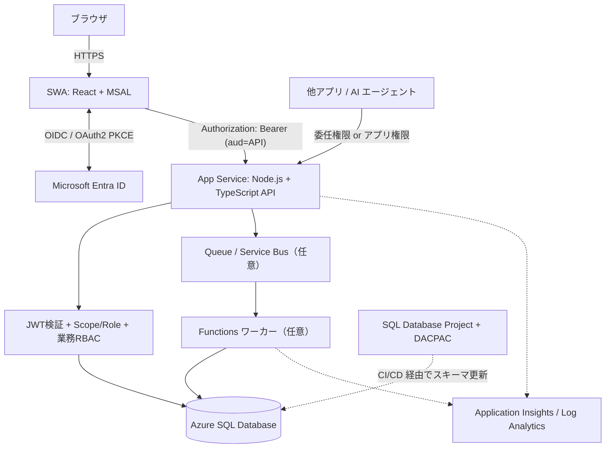

# 汎用 Azure Web アプリケーション標準テンプレート（設計方針）

更新日: 2026-10-28  
状態: 推奨標準案（実装テンプレートそのものではない）

## 1. 目的と適用範囲

Azure 上で複数の社内向け業務 Web アプリを継続的に開発するため、認証・API・データ・セキュリティ・監視・CI/CD の標準を定義する。将来の他システムや AI エージェントからの API 利用を想定し、画面と業務 API は**論理的に分離**する。物理的な分離は標準だが、小規模案件では例外を認める。

## 2. 推奨技術スタック

| レイヤー | 標準 | 説明・選定理由 |
|---|---|---|
| フロントホスティング | Azure Static Web Apps (SWA) | React SPA の静的配信、配信・デプロイを管理 |
| フロントエンド | React + TypeScript | UI コンポーネント化と静的型検査 |
| フロント認証 | Microsoft Entra ID + MSAL React | SPA で OAuth 2.0 認可コード + PKCE によるユーザー認証・APIトークン取得 |
| API ホスティング | Azure App Service | 独立した常時稼働型 HTTP API の運用 |
| API 実装 | Node.js + TypeScript | フロントとの技術統一と I/O 主体の API 開発 |
| API 認証 | Entra ID アクセストークンの JWT 検証 | 署名、Issuer、Audience、有効期限、Scope / Role を検証 |
| API 認可 | アプリ固有 RBAC | テナント/ユーザー/プロジェクト/操作などの業務権限を判定 |
| 主 DB | Azure SQL Database | リレーショナルな業務データ、整合性・トランザクション |
| 代替 DB | Azure Cosmos DB | データモデル、分散特性、アクセスパターン等が要件に合う場合 |
| DB 定義と変更 | SQL Database Project + DACPAC | SQL をスキーマの正本とし CI/CD で差分反映 |
| DB 接続 | mssql等のDBドライバー（ORM任意） | パラメーター化クエリ、接続プール、最小権限 |
| 非同期/重処理 | Azure Functions + Queue / Service Bus | CPU処理、PDF処理、長時間処理などを分離（必要に応じて C#・Python・Go） |
| API 契約 | OpenAPI | API 仕様を機械可読な JSON/YAML で管理 |
| API ドキュメント | Swagger UI 等 | OpenAPI を視覚化し試験可能にする。公開範囲を制限 |
| API 入力検証 | Zod | TypeScript の型だけでは検証できない実行時データを検証 |
| フロントデータキャッシュ | TanStack Query | サーバーステートの取得・キャッシュ・再取得・無効化 |
| 監視 | Application Insights + Log Analytics | リクエスト、例外、依存関係、ログの収集・検索・分析 |
| 計装（任意） | OpenTelemetry | トレース/メトリクス/ログの標準化。Application Insights に送信可能 |
| 秘密情報管理 | Managed Identity + Key Vault | 秘密情報のハードコードを防止。可能ならパスワードレス |
| IaC/CI/CD | Bicep + CI/CD | 開発/本番設定の再現性、検証、承認付きデプロイ |

## 3. 標準アーキテクチャ



原則として業務ロジックは API 側に置き、ブラウザや AI が直接 DB を操作しない。AI 連携のために MCP アダプターを追加する場合も業務 API の認可を迂回しない。

## 4. 認証の用語とルール

- **Entra ID**: ユーザーやアプリの ID を管理し、トークンを発行する認証基盤。
- **MSAL**: SPA が Entra ID でログインし、API 向けアクセストークンを取得する Microsoft のライブラリ。
- **Easy Auth**: Azure App Service 等のマネージド認証機能。標準案では API 側の JWT 検証ライブラリを優先。採用可能な代替。
- **BFF (Backend for Frontend)**: ブラウザの代理で API を呼び出す専用サーバー層。トークンをブラウザに保持させない設計に利用できる。高機密・セッション集中管理要件では別途検討する。
- **JWT**: 署名付きトークン形式。読み取り可能な Payload を改ざんすると通常は署名検証に失敗する。
- **Issuer (iss)**: トークンの発行者。自社が信頼する Entra テナントのみ許可。
- **Audience (aud)**: トークンの対象となる API。API 自身の識別子と照合。
- **Client ID (azp / appid)**: トークンを取得したクライアントアプリを識別。公開 SPA の Client ID だけで呼び出し元本人を証明できない。
- **Scope (scp) / Application Role (roles)**: API 呼び出し許可の種類。ユーザー委任とアプリケーション権限を区別。
- **RBAC**: 業務上のリソースと操作に対する権限の割り当て。
- **PKCE**: SPA の認可コード横取りを防ぐ OAuth 拡張。

認証の推奨設定：
1. SPA 用と API 用の Entra アプリ登録を分離。
2. MSAL で API の明示的な Scope を取得。
3. API で署名/JWKS、許可アルゴリズム、iss、aud、期限、scp/roles、必要時 azp を検証。
4. API でユーザー/プロジェクト/操作単位の業務認可。入力の oid 等をリクエスト本文から無条件に信用しない。
5. サーバー間連携では専用アプリ登録または Managed Identity を利用。最小権限。
6. トークンをログに記録しない。XSS 対策、MFA/条件付きアクセスを運用。
7. フロントで MSAL の sessionStorage を基本候補にするが、要件に応じ保管設定を選択。ブラウザにトークンが存在するリスクは残る。

## 5. セキュリティ用語・標準設定

| 用語 | 意味 | 標準での扱い |
|---|---|---|
| **CSP (Content Security Policy)** | ブラウザが読み込み/実行できるスクリプトや通信先を制限する HTTP ヘッダー | SWA の `staticwebapp.config.json` などで設定。厳格に始めて必要な配信先のみ許可 |
| **XSS** | 不正な JavaScript を画面内で実行させる攻撃 | React の通常のエスケープを維持、危険な HTML 注入を制限 |
| **CORS** | 別オリジンのブラウザ呼び出しを制御する仕組み（認証そのものではない） | 許可 Origin を限定。`*` を安易に採用しない |
| **HSTS** | ブラウザへ HTTPS 接続を強制させるヘッダー | HTTPS 前提で適切に設定 |
| **CSRF** | 認証済みブラウザに意図しない操作を実行させる攻撃 | Cookie 認証/BFF時は特に対策 |
| **Trusted Types** | 危険な DOM 注入 API に渡す値を制御 | 採用可否とライブラリ互換性を検証 |
| **DOMPurify** | 信頼できない HTML のサニタイズ用ライブラリ | リッチテキストなど HTML を描画する場合のみ採用 |
| **SAST / SCA** | ソースコード/依存ライブラリのセキュリティ検査 | CI の必須ゲート候補 |

CSPの出発点の例（外部接続先、MSAL使用、実際の静的資産構成に合わせて検証が必要）：

```json
{
  "globalHeaders": {
    "Content-Security-Policy": "default-src 'self'; script-src 'self'; object-src 'none'; base-uri 'self'; frame-ancestors 'none'"
  }
}
```

CSPだけでは XSS は防げない。入力検証、出力時のエスケープ、依存関係管理と組み合わせる。

## 6. フロントキャッシュ：TanStack Query

**TanStack Query (React Query)** は API から取得したサーバーステートのキャッシュ、再取得、リトライ、更新後の無効化を扱う。UI 状態管理（React state 等）とは目的が違う。ユーザー・テナント・プロジェクト ID などを Query Key に含め、ログアウトやアカウント切替時はキャッシュを消去する。機密データの永続化は原則避ける。

## 7. 入力検証：Zod

**Zod** は TypeScript コード内で実行時の入力スキーマを定義し検証するライブラリ。TypeScript の静的型だけでは HTTP JSON の実値は保証されない。API 境界で Zod によるチェックを行い、必要ならフロントとスキーマ共有する。Zod は業務認可や SQL インジェクション対策の代わりにはならない。

## 8. APIドキュメント：OpenAPI と Swagger

- **OpenAPI**: エンドポイント、パラメータ、認証、レスポンスを記述する標準仕様書（JSON/YAML）。
- **Swagger UI**: OpenAPI 仕様をブラウザで表示/試行する UI。OpenAPI そのものとは別物。
- API 仕様を Git で管理し、変更の互換性検査やクライアント生成にも活用する。
- 本番の「Try it out」は必要性と権限を審査し、原則制限する。

## 9. データベース：SQL Project と Prisma / Drizzle

- **SQL Database Project / DACPAC**: CREATE TABLE / VIEW / PROCEDURE 等の SQL 定義を Git で管理し、ビルドで DACPAC 化してスキーマ変更をデプロイする方式。**標準のスキーマ正本**とする。
- **Prisma**: TypeScript/Node.js の ORM。型付き DB クライアント等を提供し、独自スキーマ管理・Migration も可能。
- **Drizzle**: TypeScript ベースの SQL に近い ORM/クエリビルダー。Migration 機能もある。
- **mssql**: SQL Server/Azure SQL にアクセスする Node.js ドライバー。SQL Project と直接組み合わせ可能。

推奨は「SQL Project + DACPAC + `mssql`（パラメーター化クエリ）」から開始。ORM を入れる場合でも、**DACPAC と ORM Migration の二重管理を避ける**。DACPAC 反映後に DB スキーマを取り込む運用は要検証。破壊的差分の事前レビューと、DB の変更時だけのデプロイを標準化。

## 10. 監視・監査・OpenTelemetry

- **Application Insights**: アプリのリクエスト、例外、依存関係、性能、分散トレースを可視化。
- **Log Analytics**: Azure Monitor Logs を KQL で検索・集計するログ基盤。
- **OpenTelemetry**: ログ・メトリクス・トレースの計装/伝搬方式を統一するオープン標準。Application Insights と競合せず連携できる。必須ではなく、分散システム拡大時に採用検討。
- **監査ログ**: 「誰が、いつ、何に、何をしたか」の証跡。アプリで構造化して記録する。トレースのサンプリングと分離し、保存期間・アクセス権限・改ざん耐性を個別に設計する。

初期は Application Insights + Log Analytics を標準。必要に応じ OpenTelemetry SDK を追加する。ログ取り込み量、保持期間、トレースサンプリングは FinOps 観点で管理。

## 11. 非同期処理と技術選択

通常の CRUD / API / 外部 API 統合は Node.js + TypeScript。CPU 集約型計算、PDF/OCR、機械学習などは専用ワーカーに分離し、Python、C#/.NET、Go などを要件・ライブラリ・ベンチマークで選択する。Queue 利用時には冪等性、リトライ、デッドレター、追跡 ID、失敗時通知を設計。

## 12. テンプレートに入れるチェックリスト

- [ ] SWA / App Service / SQL の環境別 Bicep
- [ ] Entra SPA/API 登録、Redirect URI、API Scope、JWT 検証設定
- [ ] App Service のプライベート化と SWA からの到達性の PoC（SWA統合APIとPrivate Endpointの制約を確認）
- [ ] React + MSAL + TanStack Query の共通モジュール
- [ ] Zod による API 入力スキーマ、OpenAPI 仕様、Swagger UI の開発環境用公開
- [ ] SQL Project / DACPAC の CI/CD と差分レビュー
- [ ] App Insights / Log Analytics と構造化監査ログ
- [ ] CSP、CORS、HSTS、HTTPS、XSS 防止、シークレットの非出力
- [ ] 単体・統合・E2E テスト、SAST/SCA、シークレット検査
- [ ] Queue/Functions 非同期処理はオプションのテンプレートとして分離
- [ ] 開発・本番の承認付きデプロイとロールバック手順

## 13. 例外・未決定事項

1. SWA から Private Endpoint を持つ App Service へ接続する正式経路はネットワーク要件次第。標準構成に確定させる前に実証する。
2. 常時稼働不要の小規模 API は Functions 等も比較可能。
3. Cosmos DB、BFF、OpenTelemetry、ORM は全案件必須としない。
4. API を直接呼ぶ AI エージェントにはユーザー委任かアプリ権限かを明示し、業務認可と監査を必須とする。
5. これは**設計書**であり、動作するスターターコード・Bicep・CI/CD 一式の実装完了を意味しない。
