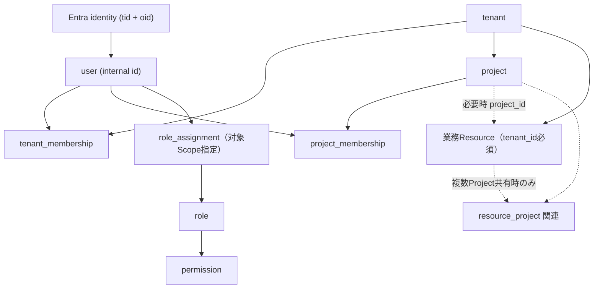

# 汎用Webアプリ開発テンプレート：Tenant・User・Resourceスコープ管理共通設計

更新日: 2026-10-30  
状態: 12項目の基本方針確定（詳細実装・PoCは別途）

## 目的と適用範囲

特定の業務アプリに依存せず、**誰が・どのTenant/Project/Resourceに・何の操作をできるか**を統一して判断するための設計。Projectを使わないアプリにも対応する。ProcureOneの業務要件をテンプレートにハードコードしない。

- 認証は[Azure Webアプリ共通テンプレート：BFF・認証認可・キャッシュ設計](azure-webapp-bff-auth-security-and-authorization-cache.md)を参照。APIは検証済みBearerトークンで呼び出し主体を特定し、認可をリクエストごとに行う。
- URL/HTTP規約は[REST API共通仕様](rest-api-common-standards.md)を参照。内部APIは `/api/v1`。Gatewayのアプリ識別子は外部公開ルートにのみ適用可能。
- Entra IDの `tid` はIDプロバイダー側テナントID。アプリ内部の `tenant_id` と**必ずしも一致しない**。マッピングを明示する。

## 決定事項（12項目）

| # | 設計項目 | 確定方針 | 留意点 |
|---|---|---|---|
| 1 | スコープ階層 | **B. 独立関連型** | Tenant配下でUser/Project/Resourceを関連付ける。Userは複数Projectに所属可 |
| 2 | テナントモデル | **B. 論理分離型** | 共有基盤・共有DBにも対応。アプリ内部Tenantを分離境界として扱う |
| 3 | ユーザー識別 | **C. 内部User ID＋Entra `tid/oid`** | メールアドレスを識別子にしない。検証済みIdentityとUserを対応付ける |
| 4 | 所属モデル | **C. Tenant Membership＋Project Membership** | Project所属は同一Tenantへの有効所属が前提。所属とPermissionを分離 |
| 5 | Projectコンテキスト | **C. UI選択＋API明示型** | UIで選択、各APIリクエストで対象Projectを明示。セッション固定を前提としない |
| 6 | コンテキスト伝播 | **B. URLパス＋必要時ヘッダー** | 基本はリソース指向パス。補助ヘッダーは例外的に使用し、重複・不整合を避ける |
| 7 | Resource所属 | **B標準＋必要時C拡張** | Tenant必須、Project任意。複数Project共有が必要なResourceだけ関連テーブルを追加 |
| 8 | スコープ別認可 | **C. RBAC＋Permission＋Scope** | 必要に応じABAC条件を追加。毎回対象Resourceと所属を検証 |
| 9 | データアクセス制御 | **B標準＋必要時RLS** | API認可＋DBアクセス層でTenant/Project絞り込みを強制。必要時にDB RLSを追加 |
| 10 | DB共通モデル | **C. 共通基盤テーブル＋業務別テーブル** | スキーマを再利用。共有DBを強制せず、DB物理分離は任意 |
| 11 | キャッシュ・整合性 | **C. TTL＋変更時失効** | キャッシュ導入は任意。権限変更時の失効を標準化 |
| 12 | 監査・セキュリティ | **C. 共通監査＋検証標準化** | 操作・拒否記録と越境アクセス/失効後アクセスの自動テスト |

## 概念モデル

概念図は関係を示すものであり、物理的なFK、制約、認可継承規則、リソースごとの関連テーブルは後続の詳細設計で確定する。

### 識別と所属

- `user` は内部で安定したIDを発行し、`user_identity` で外部ID (`identity_provider`, `tid`, `oid`) に対応付ける。同一外部IDの重複登録を防ぐ。
- Entraのトークンに含まれる `tid/oid` を検証し、内部Userへ解決する。外部ID変更・テナント移行時の紐付けは本人確認と管理手続きを要する。
- `tenant_membership` はTenant所属を、`project_membership` はProject所属を表す。所属しているだけでは操作権限を付与しない。
- ユーザー委任とクライアント資格情報によるAPI呼出しを区別し、サービスプリンシパルを人間の `user` として黙って扱わない。サービス主体に対するScope割当方法は詳細設計で定義。
- アプリ内部の `tenant_id` とEntra `tid` の対応は別管理する。単一Entraテナントから複数アプリTenantを扱う構成にも対応可能とする。

### ProjectコンテキストとAPI

- UIは選択中Projectを保持するが、APIはその状態を信用せず、リクエスト単位で対象Scopeを認可する。
- Project配下のリソースには例として `GET /api/v1/projects/{project_id}/documents` を使用する。
- Projectを持たない、または横断検索のAPIは `GET /api/v1/documents` など業務要件に即したURLとする。
- ヘッダーでProjectコンテキストを補う必要がある場合のみ `X-Project-Id` 等を使用する。URLとヘッダーの値が矛盾する場合は拒否し、同一スコープを二重指定する設計を避ける。
- URL、ヘッダー、クエリ、JSON本文にあるTenant/Project/User IDは**自己申告値**であり、権限証明として扱わない。
- BFF経由でも直接API経由でも、API側で同等の認可検証を実施する。

### Resource所属と認可

- 各Tenant固有Resourceは所属Tenantを持つ。Projectは任意。 `project_id = NULL` は全員公開を意味しない。
- `project_id` を指定する場合はResourceのTenantとProjectのTenantが一致することを保証する。
- 同一Resourceが複数Projectと関係する特殊要件のみ、Resource種別に応じた関連テーブルを追加する。関連付けだけで閲覧/編集を自動許可しない。
- RoleはPermissionの集合。Role割当はTenant/ProjectなどのScopeに結び付ける。スコープ間の権限継承・Tenant管理者権限などは暗黙に許可せず、詳細設計で明示する。
- 所属確認 → Permission確認 → Resourceの実所属・追加条件（所有者、申請者と承認者の分離等）確認のすべてを満たす場合にのみ許可。既定拒否（deny by default）。
- Resource IDだけを指定して別Tenant/Projectのデータを取得できるBOLA/IDORを防止する。

### データアクセス層とDB

- APIで認可を行い、DBアクセス層（Repository/Query層）でもTenant/Projectスコープを強制する。
- 読取だけでなく作成・更新・削除・集計・検索・バッチ処理にも適用する。更新対象Resourceの実所属を検証する。
- 共通DBアクセス機構を迂回する生SQLやバッチにも同等の制約を課す。DBのRLSは要件に応じて多層防御として導入できる。
- 物理DBの共有・分離は実装要件と運用コストで判断する。別DB構成なら共通認可API経由で参照し、業務アプリに共通DB直結を強制しない。

#### 命名規約（確定）

- **テーブル名：lower_snake_case、単数形**（`tenant`, `user_identity`, `project_membership`）
- **カラム名：lower_snake_case**（`tenant_id`, `project_id`, `created_at`）
- **主キー：`id`**、外部キー：`{参照対象}_id`（`user_id` 等）
- DB製品の予約語・ORMの複数形自動変換については、使用技術に応じて識別子の明示的マッピング等で対処する。

共通基盤の概念テーブル例：`tenant`, `user`, `user_identity`, `project`, `tenant_membership`, `project_membership`, `role`, `permission`, `role_assignment`。業務テーブル（例：`document`, `request`, `approval`）はアプリ別に設計する。これらは論理モデルの例であり、全アプリで同じ物理テーブルの設置を必須にはしない。

### キャッシュ整合性

- 権限の正本は共通認可基盤/DB。Redisなどの共有キャッシュはオプション。毎リクエスト認可し、権限データの取得のみキャッシュ可能とする。
- キャッシュ利用時はTTLを設定し、Membership/Role/Permission変更・無効化時には関連エントリを失効させる。
- キーには環境・内部Tenant・主体・必要なProject/Scope・スキーマ版など、衝突防止に必要な識別情報を含める。具体形式、TTL値、変更イベント、競合対策は詳細設計。
- Redis障害時は認証済み共通認可API/正本へフォールバックし、判定できなければ拒否。
- **TTL＋失効通知だけでは厳密な即時失効を保証しない。** 厳格な即時性が必要な操作は、正本再照合やバージョン検証等の追加策を採用する。

### 監査とセキュリティ検証

- 共通監査イベントは `timestamp` (UTC), `actor_id` / `actor_type`, `tenant_id`, `project_id` (任意), `action`, `resource_type`, `resource_id`, `outcome`, `correlation_id` 等を標準化する。
- 権限・所属の変更、重要操作、認可拒否を重点記録。必要なケースでは操作前後の変更差分も機密情報を除いて記録。
- Cookie、アクセストークン、シークレット、機密本文をログに出さない。監査閲覧権限、改ざん防止、保持/削除方針を定める。
- 自動テストに最低限含める：他Tenant拒否、他Project拒否、未所属拒否、権限不足拒否、BOLA/IDOR、Resource所属の偽装、Membership解除・権限変更後の拒否、API直接呼出し、Projectなし/複数Project共有、キャッシュ失効。
- 保存先はApplication Insights/Log Analytics/監査DBなど要件によって選ぶ。

## 実装前に詳細決定・検証する項目

1. Tenant IDの生成・Entra `tid` とのマッピング、Tenant参加/退会/無効化。
2. Role AssignmentのScope表現、継承ルール、拒否ルール、テナント横断管理者の扱い。
3. API単位のProject必須/任意と `X-Project-Id` 使用条件、矛盾時エラー形式（RFC 9457）。
4. Resourceの複数Project共有時の参照権限、移動/複製/削除の整合性。
5. DBのFK・一意制約・複合キー・インデックス・RLS導入基準とコネクション管理。
6. キャッシュキー/TTL/無効化イベント、失効時の競合、強い一貫性が必要な操作。
7. 監査ログ保管期間、機密分類、正本データの管理担当、テスト実装。

## 参考

- [OWASP Authorization Cheat Sheet](https://cheatsheetseries.owasp.org/cheatsheets/Authorization_Cheat_Sheet.html)
- [OWASP API Security Top 10 — API1:2023 Broken Object Level Authorization](https://owasp.org/API-Security/editions/2023/en/0xa1-broken-object-level-authorization/)
- [Azure SQL Row-Level Security](https://learn.microsoft.com/en-us/sql/relational-databases/security/row-level-security)
