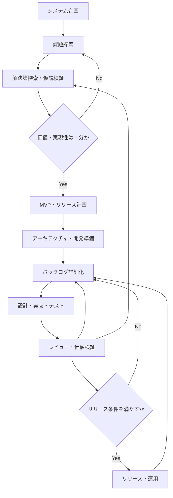
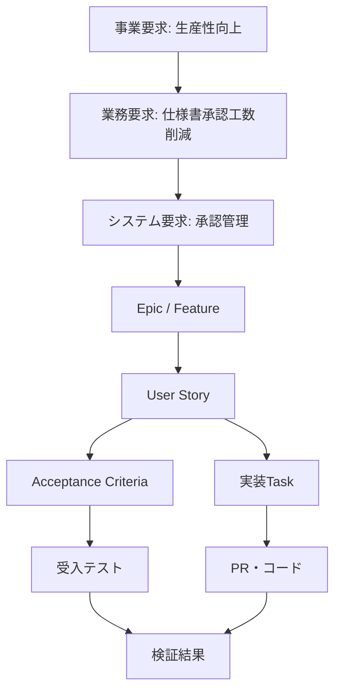
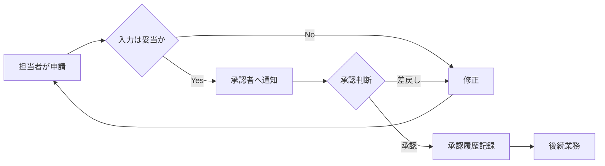
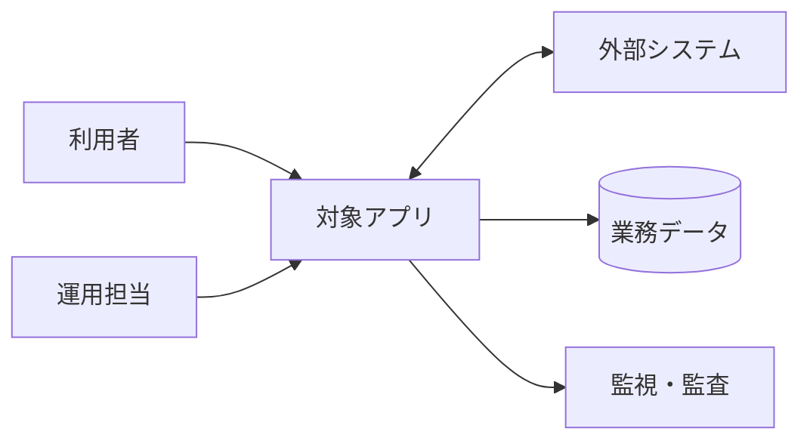
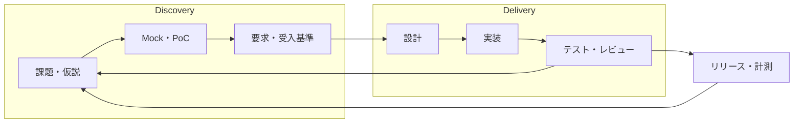
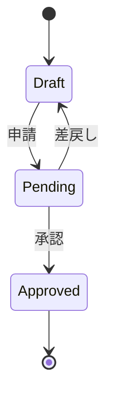
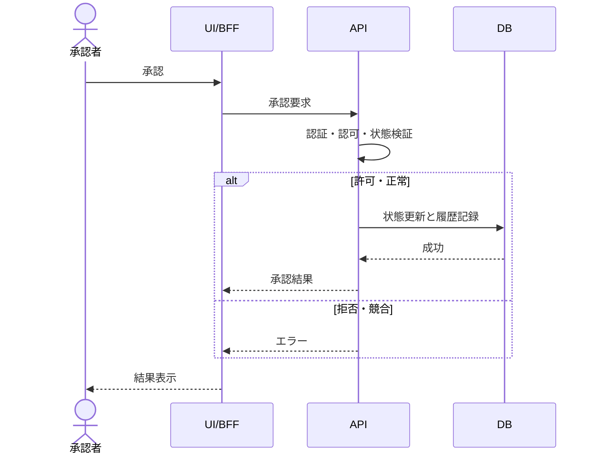
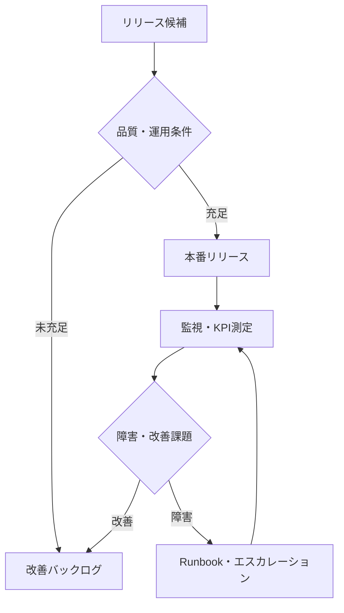
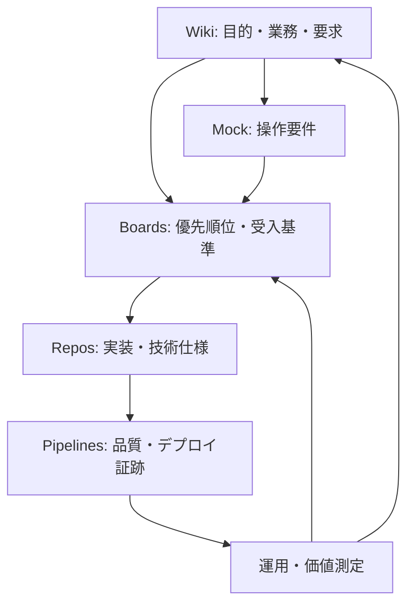

# アジャイル業務アプリケーション開発標準（ドラフト）

> 2026-11-25 初版。企業内業務アプリを対象とした実践案。Scrumの必須成果物を定義するものではない。書籍本文との逐項照合は未実施。

## 1. 基本原則

要求を定義することと、独立した要件定義書を作ることは異なる。目的・制約・重大なリスクは早期に合意し、機能詳細は必要な時点で具体化する。文書は継続更新し、正本を一つにする。共通標準は参照し、アプリ固有の差分を記録する。

## 2. 全体フロー

工程は固定ゲートではなく、必要に応じて並行・反復する。リリースはスプリント終了に限定しない。

## 3. 工程別の決定事項・成果物

| 工程 | 決定・確認事項 | 成果物 | 次に進む判断基準 |
|---|---|---|---|
| 企画 | 背景、事業目標、KPI、予算、期限、制約、責任者、代替案、投資対効果 | 企画書、ビジネスケース、関係者一覧、初期リスク | 目的・責任者・探索範囲を合意 |
| 課題探索 | As-Is、業務量、現行システム、例外、根本原因、ユーザー、業務要求、業務ルール | 業務フロー、課題・要求一覧、ロール一覧、ヒアリング記録 | 誰の何をなぜ解決するか説明可能 |
| 解決策探索 | To-Be、人とシステムの責任分界、機能概要、画面、データ、権限、外部連携、実現性 | コンテキスト図、To-Be、Mock、概念モデル、PoC・検証記録 | 優先解決策の価値と実現性を確認 |
| リリース計画 | Product Goal、MVP、優先順位、依存関係、概算、体制、リリース条件 | PRD、バックログ、ロードマップ、ストーリーマップ | 最初の価値提供範囲と着手対象が明確 |
| 開発準備 | 非機能要求、アーキテクチャ、認証認可、データ、環境、CI/CD、品質、運用 | NFR、構成図、ADR、脅威モデル、テスト戦略、DoD | 重大リスクを把握し安全に開発可能 |
| 継続的要件定義 | アクター、業務ルール、正常・異常系、権限、入出力、状態、受入基準 | User Story、受入基準、Mock、関連仕様 | 開発者が理解し検証可能 |
| 設計・開発 | API、DB、UI、処理、例外、テスト、インフラ変更 | OpenAPI、DDL、コード、テスト、Bicep、必要な設計図 | DoDを満たすインクリメント |
| 価値検証 | 要求充足、操作性、業務成立、効果、残存リスク | テスト結果、フィードバック、改善バックログ | 次の投資・改善判断が可能 |
| 運用 | 保守責任、監視、復旧、問い合わせ、移行、費用、廃止条件 | Runbook、運用体制、移行計画、リリースノート | 本番運用可能性を確認 |

## 4. 要求の階層とトレーサビリティ

要求IDとワークアイテム・PR・テストをリンクする。Epic/Featureの階層はAzure Boards向けの運用例であり、Scrumの必須階層ではない。

## 5. 初期ドキュメントのテンプレート

### 5.1 システム企画書
- 背景、目的、事業課題、対象ユーザー
- 現状KPI、目標KPI、測定方法、測定担当
- 代替手段（既存製品・業務改善・新規開発・何もしない）
- 概算費用、期待効果、期限、制約、リスク
- スポンサー、PO、業務責任者、技術・運用責任者

### 5.2 PRD
- ビジョン、Product Goal、ユーザー、業務要求
- 対象内・対象外、機能概要、MVP、成功基準
- 非機能要求への参照、外部依存、未解決事項、検証結果
- リリース方針、変更履歴、関連バックログ

### 5.3 業務要求・業務フロー
業務フローは担当者・入力・処理・出力・判断・例外を表現する。業務要求一覧は ID、要求、理由、要求元、優先度、受入確認方法、状態、関連Featureを持つ。業務ルールは条件・結果・例外・責任者を明示する。

### 5.4 システム要求
機能概要、コンテキスト、画面マップ、データ要件（項目・所有者・機密区分・保持期間）、外部連携（相手・契約・頻度・障害時処理）、権限マトリクス、非機能要求を整理する。画面仕様はMockにリンクし、複雑なルールは本文で補う。

## 6. 非機能要求とアーキテクチャ

| 分類 | 要求の確認項目 |
|---|---|
| 可用性・復旧 | 稼働時間、SLO、RTO、RPO、バックアップ、復旧検証 |
| 性能・拡張性 | 同時利用者、処理量、応答時間、増加見込み |
| セキュリティ | 認証、認可、データ分類、暗号化、監査、脅威 |
| 運用・保守 | ログ、監視、アラート、責任分界、依存関係更新 |
| データ | 保持・削除、整合性、移行、アクセス制御 |
| 利用品質 | ブラウザ、端末、アクセシビリティ、操作性 |
| コスト・規制 | 予算上限、運用費、法令・社内規定 |

各要求にID、目標値、測定条件、検証方法、責任者、優先度を持たせる。例：想定負荷下の主要画面p95応答時間2秒以内（数値は例）。

アーキテクチャでは技術スタック、ネットワーク、認証認可、DB分離、API契約、環境、IaC、CI/CD、監視、脅威と信頼境界を検討する。ADRは背景・選択肢・決定・理由・影響を記録する。共通標準に準拠する項目は参照で済ませる。

## 7. Dual Track Agile

2週間スプリントで、次の候補を探索しながら検証済みの項目を開発する。必ず1スプリント先行する必要はない。探索はPOだけの仕事ではなく開発者も参加する。

## 8. User Story / Refinement

記載項目：目的、アクター、事前条件、正常系、異常系、業務ルール、入出力、権限、状態遷移、連携、非機能要求、依存関係、受入基準、関連資料。

例：承認担当者として、割り当てられた仕様書を承認したい。後続業務へ進めるためである。

- Given 承認待ち仕様書が存在する / When 指定承認者が承認する / Then 承認済みとなり履歴が記録される。
- Given 承認権限がない / When 承認を要求する / Then 拒否されデータは更新されない。

### DoR（任意の着手確認）
- [ ] 目的・ユーザー・主要業務ルールが明確
- [ ] 受入基準、主要例外、権限が検証可能
- [ ] Mockなど必要なユーザー確認が済んでいる
- [ ] 依存関係・不確実性を把握している
- [ ] スプリント内に完成できる規模で開発者が理解している

DoRを硬直した承認ゲートにしない。

### DoD
- [ ] 受入基準を満たし、必要な自動テストが成功
- [ ] Lint、型検査、ビルド、セキュリティ検査に合格
- [ ] PRレビュー・ワークアイテム紐付け済み
- [ ] 必要な仕様・運用資料を更新
- [ ] 統合済みで利用可能なインクリメント

## 9. 詳細設計と検証

| 設計対象 | 正本 |
|---|---|
| API契約・エラー | OpenAPI |
| DB・制約 | SQL Database Projects / DDL、必要なER図 |
| UI | Mock、画面仕様、コード |
| 状態・複雑な処理 | 状態遷移図、シーケンス図 |
| インフラ | Bicep、構成図 |
| 技術判断 | ADR |
| テスト | 自動テスト、必要な手動テスト仕様 |

コードで明確な内容を別文書に重複させない。レビューでは受入基準、DoD、操作性、業務成立、価値、残存リスクを確認し、フィードバックをバックログへ反映する。

## 10. 運用・リリース

企画から運用責任者と技術保守責任者を検討する。リリース前には監視、障害対応、問い合わせ、復旧、データ移行、切り戻し、教育、費用、KPI測定を確認する。

## 11. ドキュメント管理体系

| 分類 | 成果物 | 正本 |
|---|---|---|
| Product | 企画書、PRD、ロードマップ、責任分担、リスク | Wiki |
| Business | As-Is/To-Be、課題・要求、業務ルール、ロール | Wiki |
| System | コンテキスト、範囲、NFR、データ・連携要件 | Wiki |
| Backlog | Epic/Feature/Story/Task、受入基準、優先順位 | Boards |
| UI | 画面マップ、Mock、検証記録 | Mock管理先とWikiリンク |
| Architecture | 構成、セキュリティ、API、DB、ADR、IaC | Repos |
| Quality | 開発標準、テスト戦略、DoD、実行結果 | Repos / Pipelines |
| Operations | 運用体制、監視、Runbook、移行、マニュアル | Wiki / Repos |

## 12. 作成時期

| 成果物 | 企画 | 探索 | 開発前 | 開発中・運用 |
|---|---|---|---|---|
| 企画書 | 初版 | 見直し | 合意 | 必要時更新 |
| PRD・業務要求 | 概要 | 具体化 | 優先範囲確認 | 継続更新 |
| Mock | - | 優先仮説検証 | 対象機能確認 | 必要時更新 |
| バックログ | 概要 | 作成 | 着手項目詳細化 | 継続詳細化 |
| NFR・構成 | 制約 | リスク検討 | 基本方針 | 漸進的更新 |
| API・DB・テスト | - | 必要なPoC | 着手対象 | 実装と同期 |
| 運用設計 | 責任者候補 | 業務影響 | 方針 | リリース前確認・改善 |

## 13. 規模に応じた適用

小規模では企画・PRD・業務要求・NFRを一つの文書に統合可能。中大規模では責任分界、要求追跡、リスク、移行、脅威モデルなどを独立させる。規模だけでなく機密性・業務影響・複雑性で判断する。

基本成果物は (1) 企画書 (2) PRD (3) 業務フロー・ルール (4) バックログ (5) NFR (6) アーキテクチャ・技術仕様 (7) 運用保守設計。Mockは必要な機能に作成する。共通の認証認可、API、DB、CI/CD、品質標準は再利用する。

## 14. 参考資料

- [GOV.UK Service Manual - Agile delivery](https://www.gov.uk/service-manual/agile-delivery)
- [Scrum Guide](https://scrumguides.org/scrum-guide.html)
- [アジャイルソフトウェア開発宣言](https://agilemanifesto.org/iso/ja/manifesto.html)

本資料は上記の考え方と要求工学を組み合わせたチーム向け提案であり、単一の公式標準ではない。
