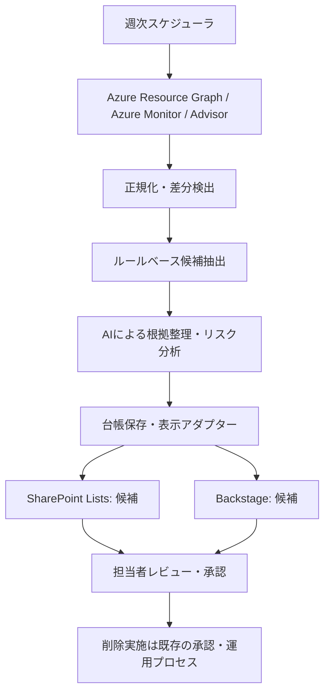

# Azureリソース管理台帳・棚卸し基盤 設計ドラフト

- ステータス: **Draft / 構成未決定**
- 作成日: 2026-11-18
- 対象: DXグループを初期スコープとし、将来の全社展開を考慮
- UI・台帳基盤候補: **SharePoint Lists / Backstage（未決定）**

## 1. 背景と目的

現状、Azureリソースは申請ワークフローを通じて構築されるが、専任のインフラ管理担当が定まっておらず、開発チーム全員が申請に参加するわけではない。そのため、知らないうちに追加・削除されるリソースがあり、管理者・用途・利用状況が把握しにくい。

**目的**
1. 管理範囲内のAzureリソースを網羅的に把握する。
2. どの業務アプリ・環境・管理者に属するリソースかを追跡する。
3. 稼働・利用状況と費用を定期確認し、未使用・削除候補を検出する。
4. AIによる評価を補助的に使い、人間が削除可否を判断する。
5. 将来のBackstage導入や全社展開を妨げない構成とする。

## 2. スコープと基本方針

- 初期対象は管理権限・情報取得許可があるDXグループのAzureサブスクリプション / リソースグループ。
- **週1回の全件棚卸し**をMVPとする。必要になれば作成・削除イベントの即時通知を追加する。
- 台帳にはAzureから取得する事実情報と、人間が管理する業務情報・判定履歴を分離して持つ。
- リソース一覧の公開範囲は未決定。アプリ名・担当部署などの一般情報と、ネットワーク・権限・構成詳細を別の閲覧区分として扱う。
- 取得・分析ロジックと、SharePoint / Backstageに表示・保存するロジックを疎結合にする。
- 資産台帳の更新は**Azureリソースそのものを変更する処理ではない**。
- AIがAzureリソースを自動削除する機能は初期対象外。

## 3. 機能要件（案）

| ID | 機能 | 内容 | 優先度 |
| --- | --- | --- | --- |
| F-01 | リソース一覧収集 | Azure Resource Graphで対象リソースを取得し、Resource IDで識別 | 必須 |
| F-02 | 台帳・差分更新 | 追加・変更・消失を検出。前回スナップショットと比較 | 必須 |
| F-03 | 業務情報管理 | アプリ/サービス、環境、管理者、用途、ライフサイクルを登録 | 必須 |
| F-04 | 定期棚卸し | 週1回実行し、成功・失敗と最終確認日時を記録 | 必須 |
| F-05 | 稼働・利用状況 | Azure Monitor等の利用可能な指標を収集。種類別に異なる指標を採用 | 高 |
| F-06 | 削除候補抽出 | ルール + Azure Advisor等で候補を検出し理由・根拠を保存 | 高 |
| F-07 | AI分析 | 候補に対する理由の要約、確認事項、リスクの提示 | 高 |
| F-08 | レビュー・承認 | 候補/調査中/維持/削除承認/削除済み等の管理、担当者確認 | 高 |
| F-09 | 通知 | 定期棚卸し結果と新規・削除・要確認リソースをTeams等へ通知 | 中 |
| F-10 | 変更イベント検知 | Event GridのARM Write/Deleteイベントを補助的に利用 | 将来 |
| F-11 | FinOps連携 | Cost Managementによる費用・推移・削減見込み | 将来 |
| F-12 | 全社展開 | サブスクリプション/部門単位のスコープ・閲覧権限・集計 | 将来 |

## 4. 暫定データモデル

### Azure由来（自動取得、原則読み取り専用）
- resource_id（一意キー）、subscription_id、resource_group
- resource_type、name、location、tags、sku（取得可能な範囲）
- 取得日時、最終確認日時、存在状態
- 利用メトリクス集計・Advisor推奨・費用（取得可能な場合）

### 人手・分析で補完
- application_id / system_name、environment（dev/prod等）
- owner_team、owner_user、用途、業務重要度
- review_status、reviewer、reviewed_at、review_comment
- recommendation_reason、evidence_period、confidence、ai_analysis_version
- deletion_approval_reference、decommissioned_at

**注意**: ARMのリソース情報だけで担当者や「使われていない」ことが確定するとは限らない。タグ不足は「未分類」とし、勝手に補完しない。

## 5. 処理フロー（案）

- 週次実行の実装候補: Azure Functions（Timer Trigger）等。
- Azure取得: Resource Graph APIを基本、詳細は必要に応じてARM / Monitor / Advisor / Cost Management API。
- 認証: Managed Identity + 最小権限のRBACを優先。
- 差分判定: Azure Resource IDをキーに前回結果と比較。取得失敗・権限変更を「削除」と誤判定しない。削除確定には再照合等を設ける。
- APIのレート制限・ページング・再試行、実行結果の監査ログが必要。

## 6. 台帳基盤の比較（採用未決定）

| 観点 | SharePoint Lists | Backstage |
| --- | --- | --- |
| 主用途 | 部門台帳・状態更新・承認運用 | アプリ/サービスCatalog・開発者ポータル |
| Azureリソース取り込み | Azure API収集処理とMicrosoft Graph等の更新アダプターを独自実装 | Azure連携プラグイン等によるCatalog取り込みが可能（適合性要検証） |
| 定期棚卸し・AI分析 | 共通バックエンドで実装 | 共通バックエンドを再利用するか、プラグイン処理を利用するか検討 |
| 保存 | SharePoint Lists | Backstage Catalog DB等。分析・レビュー履歴は別ストアも検討 |
| 部門内限定 | SharePointのサイト/リスト権限 | Permission Framework等を設計・検証 |
| 将来の全社展開 | リスト規模・運用責任を要評価 | Catalogにはアプリ/サービス中心で登録、全Azure資産の詳細は外部照会を優先検討 |

**重要**: Backstageの標準Catalog同期と、Azureリソースの取得・同期は別。プラグインの利用は共通バックエンドの完全な差し替えを意味しない。採用前にプラグインの保守状況・対象範囲・権限制御を検証する。

### 選定判断（未決定）
- 部門内の棚卸し・レビューに絞るならSharePoint Listsが軽量。
- アプリカタログ、テンプレート、CI/CDを全社統合するならBackstageが有力。
- 最初に共通データ項目と評価ルールを決め、表示先は後で選ぶ。

## 7. 削除候補判定と安全策

1. 未使用候補の例: 一定期間の低稼働、Advisor推奨、所有者不明、用途・紐付け未登録、停止済みなど。
2. 必ず**リソース種類別**に閾値を設計。低CPUだけでは削除候補の根拠にならない（待機系、DR、月次実行等）。
3. AI出力は「候補・根拠・確認事項・不確実性」であり、削除可否の最終判断ではない。
4. データ保管・バックアップ・依存関係・事業影響・保持義務を人間が確認する。
5. AIに削除権限は付与しない。削除操作は既存ワークフローと権限管理に従う。
6. 候補には評価期間・測定値・判定ルールのバージョンを保存し、監査できるようにする。

## 8. 初期MVPの範囲と未決定事項

**MVP**: スコープ限定、週次Resource Graph収集、台帳差分、担当者・用途の記録、Teams週次サマリー、削除候補の人手レビュー。利用指標・AI分析は段階追加可。

**未決定**
- SharePoint Lists / Backstage の採用
- 対象サブスクリプション、対象リソースグループ、全社拡大時の管理主体
- 標準タグとアプリ/リソースの紐付け方式
- 台帳の閲覧区分と公開範囲
- 利用状況の判定期間、リソース種別ごとの閾値
- AI分析に利用するモデル・入力データ・データ保護方針
- 削除承認責任者と既存申請ワークフローの接続方法
- 台帳保管先、履歴保持期間、監査要件
