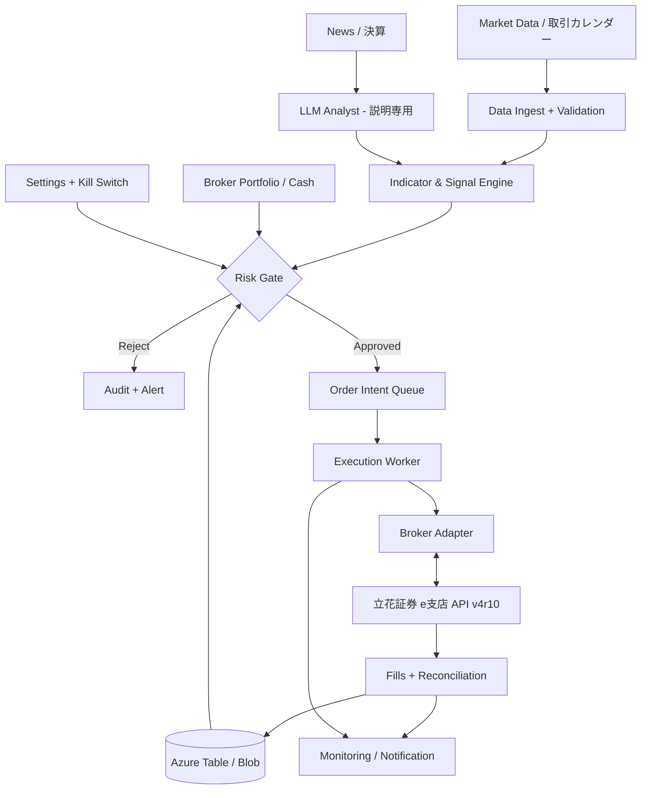

# AIスイングトレード自動売買システム — アーキテクチャ・運用設計

> 文書ID: AST-ARC-001 / 初版: 2026-11-03 / 状態: 提案設計（Broker API詳細調査を要する）
>
> [要件定義](./01-requirements.md) / [戦略と検証](./03-strategy-risk-validation.md)

## 1. 設計判断（ADR）

| ID | 決定 | 理由 / トレードオフ |
|---|---|---|
| ADR-01 | 立花証券e支店API v4r10を第一候補 | API無料、デモ環境、Linux・Python利用可能。ただしAPIの保護注文・実口座利用条件・認証仕様は実証前 |
| ADR-02 | Python 3.12系を主言語（実装時にサポート状況を再確認） | pandas・numpy・backtesting/統計の資産が豊富。型はmypy/Pydanticで担保 |
| ADR-03 | Azure Functions（Consumption）+ StorageをMVP実行基盤 | 日次〜数回/日の処理に常時稼働VM不要。短時間実行向き。接続/認証条件が不適合なら再選定 |
| ADR-04 | 戦略/リスク/発注を分離 | LLMに注文権限を与えない。Risk Engineが最終判定 |
| ADR-05 | まずCLI+通知、React画面はP1 | UIのホスティング・認証コストを後回しにして損益検証に集中 |
| ADR-06 | Demo/Paper/Liveで別設定・別ストレージ・別認証 | テスト誤発注を防止。運用はLIVE無効がデフォルト |
| ADR-07 | Azure Table Storageで状態、Blobで市場データ | 少額用途でデータベース固定費を避ける。必要ならSQLiteローカルバックテストに分離 |
| ADR-08 | IaCはBicep、CI/CDはGitHub Actions | 既存のユーザー技術セットと整合。PR保護・静的解析・テスト導入 |
| ADR-09 | ブローカー保管の保護注文が実証できるまで本番自動執行を禁止 | 数日保有では夜間ギャップ/システム障害によりローカルだけの損切りは危険 |
| ADR-10 | 日次OHLCVを基準、AIは定性的リスク補助 | 決定論性・バックテスト再現性を優先。価格予測LLM単体売買をしない |

## 2. 論理構成



**重要:** シグナル生成は売買意図（OrderIntent）まで。証券APIキーを保持できるのはExecution Workerのみ。AI Analystには注文・設定更新・Key Vault取得の権限を付与しない。

## 3. Azureリソース（MVP）

| リソース | 役割 | 推奨 |
|---|---|---|
| Azure Functions Consumption | 毎営業日の日次収集、分析、発注ワーカー、注文照合、通知 | Python、Timer Triggerを利用。実取引中の常時監視が必要なら追加監視経路を検証 |
| Azure Storage Account | Blob（日足/ログ/スナップショット）、Table（注文意図/ポジション/稼働状態）、Queue（コマンド） | Private Blob、最小権限、同時実行制御 |
| Azure Key Vault | 証券API認証情報、AI APIキー | Managed Identityで参照。ログに出さない。費用は従量 |
| Azure Monitor / Application Insights | ヘルスチェック、エラー、構造化トレース | 低保管量に制限、予算/利用量アラート |
| GitHub Actions | テスト・セキュリティ検査・デプロイ | OIDC Workload Identity FederationでAzureに接続。長期AzureシークレットをCIに置かない |
| AI API（小型モデル） | 決算/ニュース要約、シグナル根拠の文章化 | 1日1〜数回。モデル名固定、予算上限、JSONスキーマ検証 |
| React + TypeScript UI（P1） | 読取専用ポートフォリオ画面 | 本番データを匿名公開しない。認証とAPI保護の費用・方式を別途設計 |

> **断続的Functionだけでは損切りの常時保証ができない。** ブローカー側保護注文が動作していることを前提にし、注文失効・訂正・残高照合を定期実行する。APIで安全な注文が実装できない場合は、実取引へ進まず手動執行またはブローカー再選定とする。

## 4. ディレクトリ案（実装用の別リポジトリ）
```text
ai-swing-trader/
  app/
    domain/              # Trade, Position, OrderIntent, Money, RiskPolicy
    market_data/         # BrokerMarketData, Calendar, Quality
    strategy/            # indicators, conservative, aggressive
    ai_analyst/          # prompt, schema, untrusted text defense
    risk/                # sizing, limits, circuit_breakers
    execution/           # state machine, reconciliation, broker adapters
    storage/             # azure tables / blobs
    workflows/           # scheduler and jobs
    notifications/
  tests/
    unit/
    integration/
    contract/
    backtest/
    failure_injection/
  research/
    notebooks/           # research-only (production codeから分離)
  infrastructure/bicep/
  docs/runbooks/
  .github/workflows/
```

## 5. 注文ライフサイクルと冪等化
1. 市場データの取得時刻・品質・銘柄状態を確認。品質不正なら新規発注停止。
2. シグナル→`OrderIntent`を生成（`run_id, strategy_version, mode, symbol, side, planned_qty, stop_price, expiry`）。
3. Broker上の残高・注文・建玉を照合し、Risk Gateで許可/拒否を決定。
4. `(account_id, strategy_version, signal_id, side)`を一意キーとしてTable Storageに**条件付きInsert**。既存なら発注しない。
5. 対象注文キーを単一実行者がロック（Blob lease/ETagなど）。`CREATED → RISK_APPROVED → SENDING`を監査。
6. API送信後、注文受付番号を保存。`ACKED → PARTIALLY_FILLED → FILLED / CANCELLED / REJECTED / EXPIRED`で追跡。
7. **送信後タイムアウト等で結果が不明な場合、まずブローカーの注文/約定一覧を照会する**。照合不能なら人間確認まで取引停止。同じ注文を無条件で再送しない。
8. 約定した数量に応じた保護注文を確認。保護注文を置けない/失効なら新規注文停止と警報、必要なら既存建玉を安全に解消する手順へ。
9. 日次で証券上の実口座残高・約定履歴を権威データとして照合。ローカルは監査・キャッシュ。

## 6. 主データモデル

| エンティティ | 主要フィールド |
|---|---|
| `market_bar` | symbol, trade_date, open, high, low, close, volume, adjusted_flag, source, retrieved_at |
| `instrument` | symbol, exchange, trade_unit, tick_size, active, trading_status, last_checked |
| `signal` | signal_id, symbol, as_of_date, strategy_version, mode, features_hash, confidence_note, reason |
| `order_intent` | id, signal_id, symbol, side, qty, limit_price, stop_price, mode, risk_budget, state |
| `broker_order` | broker_order_id, intent_id, submitted_at, state, filled_qty, average_price, last_synced |
| `position` | symbol, qty, average_cost, protective_order_id, marked_at |
| `account_snapshot` | as_of, cash, equity, reserved_cash, realized_pnl, unrealized_pnl |
| `risk_event` | id, run_id, policy_id, action, threshold, observed, reason |
| `ai_analysis` | id, input_source_ids, model_version, prompt_hash, result_json, token_cost, validated |
| `audit_event` | occurred_at, actor, action, outcome, correlation_id, payload_hash |

設計上、日足価格はコーポレートアクション調整の有無を保持し、調整前/調整後価格を混用しない。保有資産の評価は**実約定価格と現在株価**、バックテストでの指標評価は適切に調整された系列を用いる。

## 7. スケジュール（日本時間 JST）
- **前営業日の引け後**: 最新日足・ニュース・決算日を取得、候補ランキング生成。
- **当日8:30前後**: 市場・余力・注文状態を照合。取引予定候補を確定（開始時刻は証券API受付条件に合わせ調整）。
- **取引時間中**: 保護注文/状態の照合、異常アラート。立花証券の高頻度ポーリング禁止要請に配慮し、イベント購読が可能なら優先。
- **15:30以降**: 実約定の突合、含み/実現損益の更新、日次監査。
- **週末**: 取引成績集計、パラメータ検証（本番パラメータは自動変更しない）。
- Azure FunctionsのTimer CRONは**UTC/JST差**を明示し、年末年始・日本祝日・取引カレンダーを判定。稼働のために無条件で祝日発注しない。

## 8. セキュリティ / AIガバナンス
- 本番発注権限は専用Managed IdentityでKey Vaultの当該シークレットのみ読取。AIプロセス/画面/CIへ証券キーを渡さない。
- `live_enabled=false`がデフォルト。LIVEへの変更は所有者が二重確認を伴う手動操作をし、監査記録を残す。
- LLM出力には`symbol, summary, risk_flags, source_ids, model_version`等の**閉じた構造化スキーマ**を要求。自然文をコード/コマンドとして実行しない。
- ニュース/HTML/開示情報は**未信頼データ**として扱い、LLMへの秘密情報入力とプロンプトインジェクションを禁止。
- LLMが候補を高評価しても、戦略・Risk Gateの決定論的制限を超えられない。AI APIが故障したら取引を止めるか、AIなしの検証済み戦略のみを許可。
- 日次予算・月次クラウド予算でアラート。Azure Budgetアラートは即時請求遮断ではないため、アプリ側にもLLM呼出上限を設定。
- 個人アカウント・APIシークレットの本番保存をGitHub公開リポジトリで行わない。秘密はコードレビュー/ログでもマスク。
- CI: Ruff, mypy, pytest, pip-audit/依存検査, detect-secrets, Bicep lint, contract test, backtest regression。
- CD: 検証環境へ自動、本番デプロイと取引有効化は別の承認。プログラムのデプロイだけでLIVE開始しない。

## 9. ネットワークと復旧
- Public outbound HTTPSだけで動作できるかをAPI利用規約・認証方式とともに検証。IP制限/固定IPが必要になった場合はNAT Gateway等の固定費を再見積し、MVPには無理に導入しない。
- `data_stale`, `broker_disconnected`, `auth_expired`, `protective_order_missing`, `position_mismatch`, `unexpected_fill`, `order_timeout`, `cost_spike`を監視。
- 回線断・APIタイムアウト: 注文受付不明なら安全側停止→再同期。無条件リトライ不可。
- Key Vault障害: 新規発注停止。既存ポジションについてブローカー側に注文が残っていることが重要。
- 誤発注: キルスイッチ + 新規注文停止 + 既存注文照合 + 手動介入。キルスイッチは**注文取消や建玉決済を自動保証しない**。
- 復旧訓練: 再起動中の約定、部分約定、ストップ失効、祝日遅延、二重Timer、証券APIバージョン変更をテスト。

## 10. 月額費用（概算・検証前）
| 費目 | 低頻度MVPでの概算 | 注意 |
|---|---:|---|
| 立花証券API | 0円 | **売買手数料は別**。取引可能な口座/商品を確認 |
| Azure Functions | 0〜数百円 | Consumption無料枠は条件あり。Storage等は別 |
| Blob + Table + Queue Storage | 数十〜数百円 | リクエスト/容量/冗長性による |
| Key Vault + Monitor | 数十〜数百円以上 | API呼出数/ログ取り込み量次第 |
| 小型LLM API | 100〜800円程度を仮置き | 利用モデル・単価・ニュース件数・トークン次第 |
| **目標** | **500円/月以下** | 目標であり保証値ではない。初期費用や運用工数は未算入 |
| **許容上限** | **2,000円/月（ソフト上限）** | 超過予測時AI停止・通知。発注保護の監視は安易に停止しない |

個別のクラウド価格/地域/消費量についてAzure Pricing Calculatorで見積後に確定する。立花証券の現物個別手数料コースは**10万円以下の注文1回で税込77円**の例。10万円以下の買い・売り1回ずつなら往復154円。約定金額や手数料コースで変わる。取引税・配当・税制・為替は別。

## 11. API仕様・料金の根拠（2026-11-03）
- https://www.e-shiten.jp/e_api/ （API仕様 v4r10）
- https://www.eshiten.com/api/ （無料 / Linux / デモ）
- https://www.e-shiten.net/api/20260728.html （v4r10導入、v4r9廃止）
- https://www.e-shiten.co.jp/api/20260310.html （大量・頻繁なAPI呼出への注意）
- https://www.eshiten.com/TorihikiRule/cost/ （現物手数料）
- https://www.e-shiten.co.jp/Service/web_system.html （Web画面の逆指値 / ダブル注文。**API対応は別途確認**）
- https://learn.microsoft.com/en-us/azure/azure-functions/pricing （Functions Consumptionの無料枠 / 課金対象）
- https://www.jpx.co.jp/markets/other-data-services/j-quants-api/index.html （J-Quantsは別のデータサービス）
