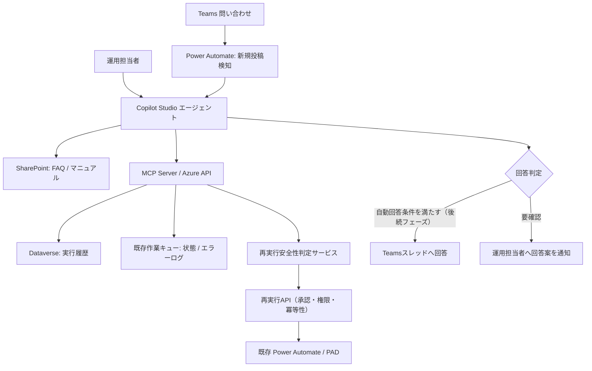

# RPA運用支援AIエージェント 設計案（PoC）

- 作成日: 2026-10-16
- バージョン: 0.1
- ステータス: Draft / TBDを含む
- 対象: 図書ハンドリングRPA（Power Automate cloud / Desktop、Dataverse、作業キュー）
- 本資料は構想・PoC設計であり、技術・ライセンス・運用判断は未確定。

## 1. 目的とスコープ

RPAの問い合わせと障害対応にかかる調査・判断工数を削減する。

1. Teams問い合わせに対し、マニュアル・FAQ・実行履歴・作業キューのログを調査し、根拠付き回答案を作成する。
2. エラーを検出・解析し、再実行可否と理由を提示する。
3. 人の承認とサーバー側の安全性検証を通した場合のみ再実行を許可する。
4. 検証後、低リスク問い合わせの自動回答、および将来的な限定的自動復旧に拡張する。

### PoC範囲

- Teamsチャネルの新規投稿を入口とする。スレッド返信・DM検知はTBD。
- 初期は問い合わせへの**自動公開返信を行わず**、担当者に回答案・参照根拠・スコアを通知する。
- 運用者はCopilot Studioのチャットから失敗ジョブの調査を手動起動できる。
- 再実行は初期PoCでは自動化しない。安全性判定と実行APIは段階的に開発する。
- 既存のPAC/PADフローは原則維持する。

## 2. 論理アーキテクチャ

### コンポーネントの責務

| コンポーネント | 責務 |
|---|---|
| Teams | 問い合わせ受付、最終回答 |
| Power Automate | チャネル投稿検知、連携・通知、既存処理起動 |
| Copilot Studio | 意図分類、ナレッジ検索、ツール呼び出し、回答案生成 |
| Azure API / MCP | 実行情報の取得、権限検証、共通調査機能の提供 |
| Dataverse | 既存のRPA実行履歴参照（対象テーブル・列はTBD） |
| 作業キュー | 既存の状態・エラーログを参照（実体・データモデルはTBD） |
| SharePoint | FAQ、利用ガイド、業務仕様・運用ナレッジ |
| 再実行サービス | AIとは独立して実行条件を検証し、重複処理を防止 |

> 注意: 作業キューにはエラーログが既に存在する。Dataverseと作業キューの関係・保存先は未確認。API接続方式はPoCで決定する。Copilot Studioへの自動イベント投入方法も接続制約を事前検証する。

## 3. 問い合わせ対応フロー

1. Teamsで新規問い合わせを検知。投稿ID・スレッドIDを記録し、ボット自身の投稿・重複イベントを除外する。
2. 質問内容から問い合わせ種別（使い方、実行状況、既知エラー、その他）を判定する。
3. FAQ・マニュアルを検索し、必要に応じてMCPから該当ジョブ・ログを取得する。
4. 回答案、出典、確認済み事実、未確認事項、スコアを生成する。
5. PoCでは担当者へ通知。後続フェーズのみ自動回答条件に基づいて同じTeamsスレッドへ返信する。
6. 内容・根拠・実行ツール・判定・承認・送信結果を記録する。

### 自動回答ゲート（暫定）

- 想定スコア: 100点満点、90点以上を自動回答**候補**とする（確率としての90%ではない）。
- 評価軸案: 根拠の明確さ35、質問との適合25、ログ等の事実確認25、回答の完全性15。
- AIの自己採点のみで公開可否を決めない。根拠資料との整合、権限、分類、リスク、重複、ハルシネーションを別途チェックする。
- 権限変更、機密情報、破壊的操作、再実行指示、安全性が曖昧な案件はスコアに関わらず人手確認。
- 過去20〜50件程度の実問い合わせで正誤、誤った高スコア回答、回答に必要な情報、実際の運用負荷を評価し、配点と閾値を較正する。
- PoC中は自動回答OFF。

## 4. RPAエラー調査・復旧フロー

1. 運用者が「今日失敗したRPAを調査して」と依頼する（将来は定期実行・エラーイベントでも起動可能）。
2. 失敗ジョブ一覧・エラーログ・ステップ・現在状態・過去履歴を取得する。
3. 原因候補、影響範囲、実行済み副作用、追加確認項目を整理する。
4. 再実行サービスが安全性を評価し、`SAFE / UNSAFE / UNKNOWN` と根拠を返す。UNKNOWNは実行禁止。
5. SAFEかつ権限・承認を満たす場合だけ再実行する。実行直前にも状態を再検証する。
6. 再実行結果、判定証跡、承認者、時刻を監査ログに記録する。

### 再実行安全性の必須条件

- 対象は失敗・再試行許可状態であり、別処理が同時実行していない。
- 再試行によるBox移動、メール通知、登録処理等の重複副作用が起きないことを確認できる。
- 実行ステップ、外部処理完了状況、再開位置が特定できない場合はUNKNOWN。
- 排他制御、冪等キー、リトライ回数・上限、実行前後の監査ログ、API側認可を備える。
- ログ本文を命令として扱わない（プロンプトインジェクション対策）。
- AIの回答・スコアは承認や安全性の保証にならない。

## 5. MCP / API候補

| ツール名 | 処理 | 権限 |
|---|---|---|
| `list_failed_jobs` | 失敗ジョブ一覧 | 読取 |
| `get_job_status` | ジョブ状態 | 読取 |
| `get_error_logs` | エラーログと失敗ステップ | 読取 |
| `get_job_history` | 履歴・再試行回数 | 読取 |
| `check_retry_safety` | 再実行条件のルール判定 | 読取 |
| `retry_job` | 安全性・権限・承認を再評価後にジョブ実行 | 更新 |

問い合わせエージェントは原則読み取りのみ。再実行ツールは運用担当者専用とし、ツール非表示に頼らずAPI側で認可する。単純なFAQ検索はMCPを経由せずCopilot Studioのナレッジ機能で対応する。

## 6. データ・監査

| データ | 配置案 | 状態 |
|---|---|---|
| 実行履歴・エラー | 既存Dataverse / 作業キュー | 既存構造を要確認 |
| FAQ・ユーザーガイド | SharePoint | TBD: サイト、アクセス権 |
| 問い合わせ・AI回答履歴 | SharePoint List等 | TBD: 保存先・列 |
| 再実行の承認と操作履歴 | 監査ログ | TBD: 保存先・保存期間 |

問合せ者の本人性確認、対象プロジェクト単位の権限制御、ログ内の個人情報・秘密情報マスキング、最小権限を必須とする。

## 7. 段階導入

| Phase | 内容 | 完了条件案 |
|---|---|---|
| 1 | Teams投稿検知、FAQ調査、回答案・スコア生成（人手確認） | 担当者が結果・根拠を確認できる |
| 2 | Dataverse / 作業キュー調査APIとMCP統合 | 実行状況・エラーが参照できる |
| 3 | 条件付きTeams自動回答 | 検証済みカテゴリで誤った自動回答を抑制 |
| 4 | 再実行可否判定・人手承認・再実行API | 重複処理を防止し監査可能 |
| 5 | 定期エラー検知・限定的自動復旧 | 運用条件・安全性検証を満たす |

## 8. PoC評価指標（仮目標）

- 問い合わせ正答率: 90%以上（TBD: 採点方法）
- 重大な誤自動回答: 0件
- 回答時の根拠提示率: 100%
- エラー調査時間: 現状比50%削減（TBD: ベースライン）
- 再実行による二重処理: 0件

## 9. TBD（未決事項一覧）

| ID | 項目 | 決定に必要な確認 |
|---|---|---|
| TBD-01 | Teams入口 | 対象チャネル、スレッド返信/DMの扱い、投稿権限 |
| TBD-02 | イベント連携 | Power Automate→Copilot Studio呼出方式、スレッドへの返信方式と制約 |
| TBD-03 | ライセンス・費用 | Copilot Studioクレジット、コネクタ・MCP・Azure料金、サービスアカウント |
| TBD-04 | Dataverseデータモデル | 環境、テーブル、実行履歴・失敗状態・エラーログの取得方法 |
| TBD-05 | 作業キューの実体 | Dataverse/SharePoint/その他、ステップ別ログ、相関ID |
| TBD-06 | APIホスティング | Azure FunctionsかApp Service、認証、ネットワークと社内申請 |
| TBD-07 | MCP認可 | エージェント利用者の権限継承、サービス認証、ユーザー別閲覧範囲 |
| TBD-08 | ナレッジ | FAQと業務仕様の格納場所、更新責任者、バージョン管理 |
| TBD-09 | スコアリング | 採点器、評価データ、閾値90の妥当性、カテゴリ別ゲート |
| TBD-10 | 問い合わせ監査 | ログ項目、保存期間、問い合わせへの個人情報対策 |
| TBD-11 | 再実行条件 | フロー別の副作用、処理済み判定、再開ポイントと冪等性 |
| TBD-12 | 再実行承認 | 運用者ロール、承認UI、期限、二重承認要否 |
| TBD-13 | 実行API | 既存PACフロー呼出し方法、排他・失敗時挙動・再試行制御 |
| TBD-14 | 定期監視 | 頻度、通知先、アラート抑制・メンテナンス期間との関係 |
| TBD-15 | PoC評価 | テスト件数、評価者、受入基準、実運用移行判断 |

## 10. 基本方針

既存のPAC/PADと作業キューを維持し、共通の読み取りAPI / MCPを問い合わせ支援と障害調査で共有する。AIには説明と提案を担当させ、更新系の最終判断は検証可能なAPIロジックと人間の承認で制御する。
